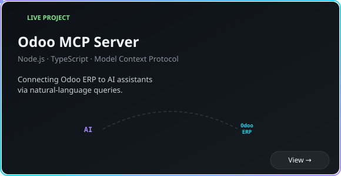
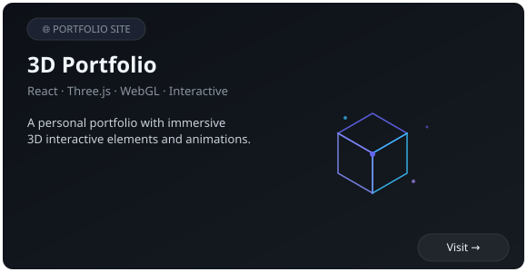

  

---

## 🛠️ Tech Stack

| Layer | Technologies |
|---|---|
| **Frontend** | React, TypeScript, JavaScript, HTML, CSS |
| **Data & State** | GraphQL, React Query |
| **Testing** | Jest, Cypress |
| **Backend** | Node.js, PHP / Laravel |
| **Tools** | Git, Docker, Sentry |
| **Exploring** | Model Context Protocol (MCP), AI integrations |

---

## 💼 Professional Experience

### Toptal — Frontend Engineer, Core Team
*February 2022 – October 2024*

Contributed to internal products and frontend infrastructure supporting Toptal's talent and client experiences.

- **Resume UI:** Contributed to the frontend experience of Toptal's [Resume](https://www.toptal.com/resume) product.
- **Picasso UI Library:** Developed reusable components for Toptal's internal React component library built around Material UI.
- **Talent Portal:** Worked on talent onboarding, profile completion workflows, and GraphQL API integrations.
- **Client Portal:** Developed interface components from Figma designs to improve the client experience.
- **Technical Quality:** Fixed bugs, maintained automated tests, improved legacy code, and supported safer feature releases.

> *These were professional projects developed at Toptal; their internal source code is not presented as personal open-source work.*

---

## 🚀 Personal Projects

  
  

  

---

## 🌱 Currently Interested In

- Contributing to open-source projects
- Building useful developer tools
- Improving code quality and developer experience
- Exploring AI integrations and modern development workflows

---

  

  &nbsp;&nbsp;
  &nbsp;&nbsp;
  

